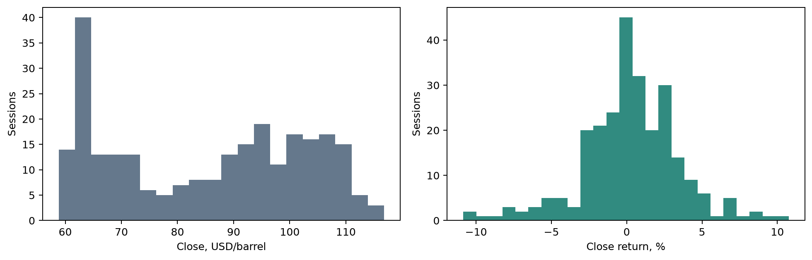
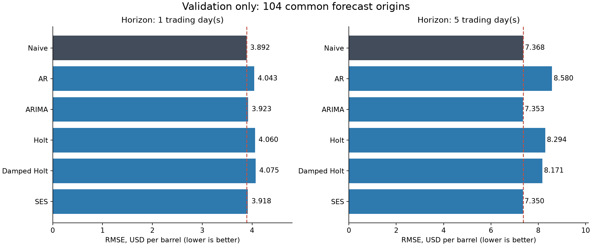
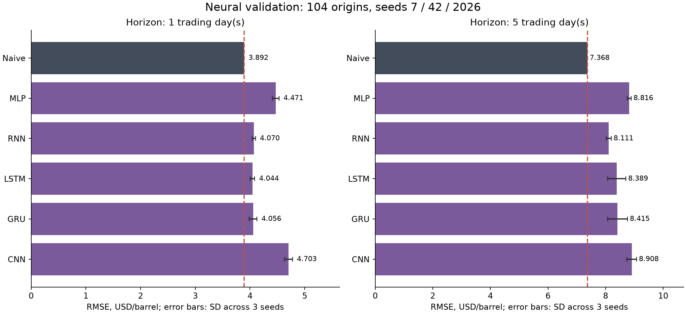
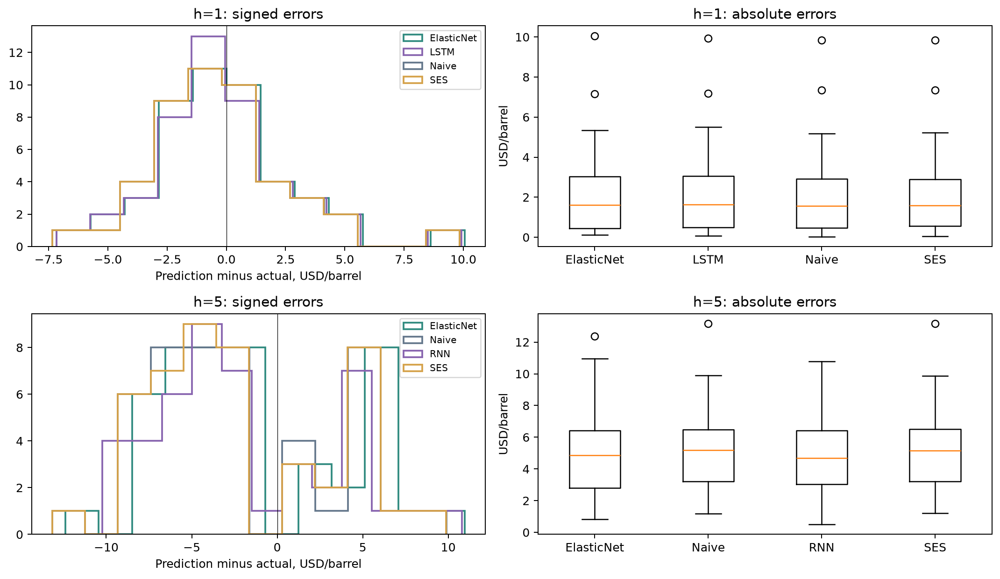
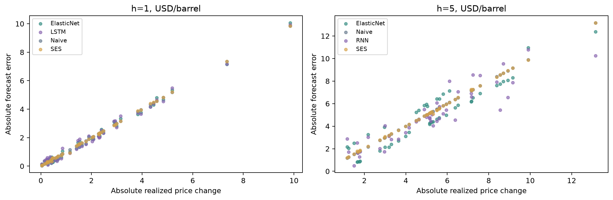
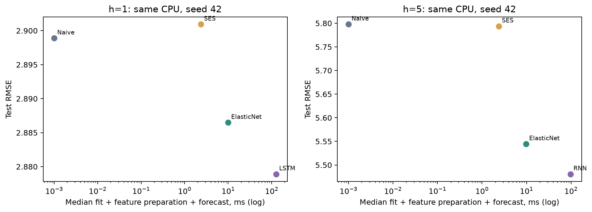

# Прогнозирование дневной цены нефти Brent

**Практические занятия 8–9 · Анализ данных и машинное обучение · Команда № 4**

В работе исследуется прогнозирование дневной цены закрытия нефти Brent на **1 и 5 торговых сессий вперёд**. Использованы котировки `BRENT.CMD/USD` от Dukascopy за один год. Сравниваются простые прогнозы, классические статистические модели, методы машинного обучения и нейросети.

Основной вопрос — дают ли более сложные модели заметное и устойчивое преимущество перед прогнозом, в котором будущая цена считается равной последней известной. Для ответа недостаточно выбрать минимальную ошибку в одной таблице: необходимо проверить, как получены данные, какие наблюдения были доступны моделям, как меняется результат на разных горизонтах и насколько он зависит от случайной инициализации.

**Краткий результат.** На отложенном тесте минимальный RMSE для горизонта 1 день получен у LSTM (2,8789 против 2,8989 у Naive), для 5 дней — у RNN (5,4807 против 5,7978). Однако парные интервалы неопределённости включают ноль, а выбор модели зависит от метрики и инициализации. Убедительного устойчивого преимущества сложных методов в рамках этого исследования не установлено.

## 1. Задача и исследовательские вопросы

Пусть $P_t$ — цена закрытия известной торговой сессии, а $\hat P_{t+h}$ — прогноз на $h$ последующих активных сессий, где $h \in \{1,5\}$. Прогноз строится после завершения сессии $t$ и должен использовать только информацию, доступную к этому моменту.

В исследовании проверяются три рабочих предположения:

1. **Сложные модели могут уменьшить ошибку относительно Naive.** Проверка проводится по RMSE на общей валидации и затем на отдельном тестовом периоде.
2. **На горизонте 5 сессий прогноз менее точен, чем на горизонте 1 сессия.** Сравниваются ошибки обоих горизонтов при одинаковых датах формирования прогноза.
3. **Выигрыш нейросети может быть нестабильным.** Поэтому для каждой архитектуры используются три заранее заданных случайных seed и дополнительно изучаются ошибки на разных отрезках времени.

Это гипотезы для конкретной выборки и выбранных методов, а не утверждения о предсказуемости рынка Brent в целом. Основной критерий отбора моделей — **RMSE**: крупные ошибки прогноза цены в нём имеют больший вес. Дополнительно рассчитываются MAE, sMAPE и точность направления изменения цены.

## 2. Данные

| Параметр | Значение |
|---|---|
| Источник | [Dukascopy, `brentcmdusd`](https://www.dukascopy-node.app/instrument/brentcmdusd) |
| Инструмент | `BRENT.CMD/USD`, CFD на нефть Brent |
| Показатель | Дневная цена закрытия `close`, сторона котировки `bid` |
| Единица измерения | USD за баррель |
| Период | 28.10.2025–27.10.2026 включительно |
| Частота | D1, временные метки UTC |
| Исходный набор | 365 календарных строк |
| Рабочий набор | 258 активных торговых сессий |

Конечная дата запроса к источнику — 28.10.2026, она **не включается** в выгрузку. Дата выбрана относительно выдачи задания 28 октября 2026 года: в анализ вошли полные UTC-дни до этой даты.

Важно, что здесь используется **котировка CFD**, а не официальная расчётная цена фьючерса ICE. Временная метка дневной свечи указывает начало UTC-интервала; `close` считается доступным только после завершения соответствующего дня. Это позволяет однозначно определить, в какой момент формируется прогноз. Особенности CFD, расписания и корректировок разобраны в [описании источника и принятых решений](docs/data_decisions.md).

### Очистка и контроль качества

Из 365 строк исключены 107, у которых одновременно `volume = 0` и `open = high = low = close`. Из них 104 приходятся на субботу и воскресенье, ещё три — на **25.12.2025, 01.01.2026 и 03.04.2026**. Все исключения сохранены в [отдельном CSV](results/excluded_rows.csv).

Проверены порядок и уникальность дат, пропуски, конечность и положительность цен, неотрицательность объёма и согласованность OHLC. Пропущенных календарных строк и нарушений этих проверок не обнаружено. Активные цены не интерполировались, не сглаживались, а сильные изменения не удалялись.

Повторная выгрузка дневных котировок побайтово совпала с сохранённой. Для десяти крупнейших абсолютных изменений цены дневные OHLC сверены с часовыми свечами. Это подтверждает согласованность разных частот **одного поставщика**, но не заменяет независимую проверку рыночных цен или истории корректировок CFD.

В рабочем наборе `close` меняется от **58,838 до 116,797 USD/баррель**, среднее значение — **85,1793 USD/баррель**. Стандартное отклонение односессионного относительного изменения составляет **3,2538%**.




Исходный CSV находится в [`data/raw/`](data/raw/), очищенный — в [`data/processed/`](data/processed/), материалы сверки по часам — в [`data/validation/`](data/validation/). Точные правила очистки реализованы в [`src/audit_data.py`](src/audit_data.py).

## 3. Организация эксперимента

В качестве единицы времени используется **активная сессия**, а не календарный день. Поэтому горизонт 5 означает цену закрытия через пять следующих активных наблюдений.

| Этап | Индексы последней известной цены (`origin`) | Даты `origin` | Количество прогнозов на горизонт |
|---|---|---|---:|
| Начальная история | 0–99 | 28.10.2025–18.03.2026 | 100 известных цен |
| Валидация v1 | 99–132 | 18.03–05.05.2026 | 34 |
| Валидация v2 | 133–166 | 06.05–22.06.2026 | 34 |
| Валидация v3 | 167–202 | 23.06–11.08.2026 | 36 |
| Промежуток до начала теста | 203–206 | После валидации | Не оценивается |
| Финальный тест | 207–252 | 18.08–20.10.2026 | 46 |

Начальная история и первый `origin` валидации пересекаются по индексу 99: цена этой сессии уже известна к моменту первого прогноза. Всего на валидации получается **104 прогноза на каждый горизонт**, на финальном тесте — **46**. Точные пары дат прогноза и целевой цены приведены в [`config/split_manifest.csv`](config/split_manifest.csv).

### Как исключено использование будущего

На момент формирования прогноза в точке $t$ модель получает только `close[0:t+1]`. Для обучающего примера с начальной точкой $j$ целевая цена допустима лишь при условии:

$$
j+h \leq t.
$$

Например, прогнозируя цену через пять сессий в точке $t$, нельзя обучаться на примере, для которого фактическое значение станет известно только в $t+1$. Это ограничение проверяется при построении обучающих выборок.

Другие правила эксперимента:

- Признаки рассчитываются по известной части ряда; будущие `close`, `high`, `low` и другие значения в них не попадают.
- Масштабирование входов и целевых изменений выполняется только на допустимой обучающей части, отдельно для каждой точки прогноза.
- Все модели сравниваются на **одних и тех же `origin` и `target`** внутри каждого горизонта.
- На каждом следующем `origin` история расширяется, а модель заново обучается с уже выбранными настройками. Известные к этому моменту цены тестового периода использовать можно; подбирать настройки по тестовым ошибкам нельзя.
- Для статистических моделей пятишаговый прогноз строится без подстановки фактических промежуточных будущих цен.

Параметры выбора и победители семейств были зафиксированы до расчёта тестовых метрик в [`config/final_lock.json`](config/final_lock.json). Этот файл также хранит контрольные суммы исходных компонентов эксперимента. Подробная схема проверки — в [`docs/experiment_protocol.md`](docs/experiment_protocol.md).

## 4. Сравниваемые методы

Исследованы четыре семейства, **по пять подходов в каждом**. Для всех используется один источник — история `close`; различаются представление признаков, способ обучения и построение прогноза.

| Семейство | Подходы | Что проверяем |
|---|---|---|
| Простые методы | Naive, drift, rolling mean, rolling median, seasonal naive | Можно ли получить хороший прогноз без обучения сложной модели? |
| Статистические | AR, ARIMA, SES, Holt, damped Holt | Помогает ли линейная зависимость, сглаживание уровня или оценка тренда? |
| Машинное обучение | Ridge, Elastic Net, Random Forest, Gradient Boosting, SVR | Есть ли полезная связь между историческими характеристиками цены и будущим изменением? |
| Нейросети | MLP, RNN, LSTM, GRU, CNN | Могут ли небольшие сети извлечь дополнительную информацию из последовательности изменений цены? |

**Naive** — обязательный ориентир: $\hat P_{t+h}=P_t$. Он не обучается и предполагает сохранение последней известной цены. Если сложная модель не даёт устойчивого выигрыша относительно этого правила, её вычислительная стоимость требует отдельного обоснования.

Статистические методы работают с последовательностью уровней цены. Для ARIMA исследуется ограниченная сетка моделей с одной разностью; для сглаживания — модели с уровнем, трендом и затухающим трендом. Пятишаговая траектория рассчитывается из одной известной истории.

Для ML сформированы **14 признаков** на основе прошлого `close`: пять лаговых односессионных изменений, momentum за 5/10/20 сессий, волатильность за 5/10/20 сессий и отклонение цены от скользящего среднего за 5/10/20 сессий. Прогнозируется изменение цены в USD за соответствующий горизонт, после чего к нему прибавляется текущий `close`.

Нейросети получают одинаковое окно из **20 прошлых относительных изменений**. Использованы небольшие архитектуры со скрытой размерностью 8, 60 эпохами и оптимизатором AdamW. Для каждой сети заданы `seed = 7, 42, 2026`. Предобученные модели не использовались.

Внешние рынки и макроэкономические показатели в признаки не добавлялись: для них отдельно пришлось бы проверять время появления каждого наблюдения. Это осознанное ограничение объёма работы, а не утверждение, что такие факторы бесполезны.

Настройки выбирались по наименьшему **валидационному RMSE** для каждого горизонта; при точном равенстве использовались MAE и идентификатор конфигурации. Для нейросетей сравнивалось среднее RMSE по трём seed, а не лучший отдельный запуск. В качестве основного тестового запуска заранее выбран `seed = 42`; остальные инициализации также сохранены.

Полные сетки находятся в [`config/statistical.json`](config/statistical.json), [`config/ml.json`](config/ml.json), [`config/neural.json`](config/neural.json), а аргументация выбора методов — в [`docs/methods.md`](docs/methods.md). Всего проверены 9 простых, 12 статистических и 15 ML-конфигураций, а также 5 нейросетевых архитектур с тремя инициализациями. Эти варианты не являются независимыми друг от друга гипотезами.

## 5. Метрики качества

Все показатели рассчитываются **по прогнозируемой цене в USD/баррель**, а не по стандартизованным значениям или внутреннему выходу модели.

| Метрика | Как интерпретируется |
|---|---|
| **MAE**, USD/баррель | Средняя абсолютная величина ошибки. |
| **RMSE**, USD/баррель | Среднеквадратичная ошибка; сильнее реагирует на крупные промахи. Основной критерий выбора. |
| **sMAPE**, % | Симметричная относительная ошибка прогноза цены. Меньше — лучше; это **не** процент «правильных прогнозов». |
| **Directional Accuracy (DA)**, % | Доля совпадений знака прогнозируемого и фактического изменения цены относительно `close[t]`. |
| **Coverage**, % | Доля случаев, в которых модель вообще прогнозирует ненулевое изменение. Нужна для правильной трактовки DA. |

У Naive прогнозируемое изменение всегда равно нулю. Поэтому у него `Coverage = 0%`, а `DA = 0%` при ненулевых фактических движениях. Это **не значит, что прогноз уровня цены у Naive плохой**: метрика направления в таком случае не отражает качество его основной задачи.

## 6. Результаты валидации

Ниже приведены лучшие конфигурации каждого семейства на **104 общих `origin`**. Для нейросетей указано среднее метрик трёх инициализаций.

| Горизонт | Семейство | Выбранная модель | RMSE, USD | MAE, USD |
|---|---|---|---:|---:|
| 1 сессия | Простые | Naive | **3,8921** | **2,9947** |
| 1 сессия | Статистические | SES | 3,9180 | 3,0390 |
| 1 сессия | ML | Elastic Net | 3,9410 | 3,0188 |
| 1 сессия | Нейросети | LSTM | 4,0436 | 3,0695 |
| 5 сессий | Простые | Naive | 7,3680 | **6,3101** |
| 5 сессий | Статистические | SES | **7,3505** | 6,3170 |
| 5 сессий | ML | Elastic Net | 7,9213 | 6,6864 |
| 5 сессий | Нейросети | RNN | 8,1105 | 6,7431 |

На однодневном горизонте лучший RMSE на валидации показывает Naive. На пятидневном SES опережает его по RMSE примерно на **0,24%**, но уступает по MAE; в двух из трёх валидационных блоков преимущество по RMSE отсутствует. Устойчивого улучшения в пользу статистической модели на этом этапе не видно.

Подробные сравнения: [статистические модели](docs/statistical_results.md), [ML](docs/ml_results.md), [нейросети](docs/neural_results.md), [проверка по блокам](docs/validation_stability.md).





## 7. Финальный тест

После выбора конфигураций выполнена отдельная оценка на **46 одинаковых точках формирования прогноза на горизонт**. Это rolling-origin тест: модели получают только уже доступную историю и не перенастраиваются по ошибкам теста.

| Горизонт | Модель | RMSE, USD | MAE, USD | sMAPE, % | DA, % |
|---|---|---:|---:|---:|---:|
| 1 сессия | **LSTM** | **2,8789** | 2,0658 | 2,0615 | 56,52 |
| 1 сессия | Elastic Net | 2,8865 | **2,0619** | **2,0574** | 60,87 |
| 1 сессия | Naive | 2,8989 | 2,0835 | 2,0814 | — |
| 1 сессия | SES | 2,9009 | 2,0839 | 2,0819 | 43,48 |
| 5 сессий | **RNN** | **5,4807** | 4,9191 | 4,9097 | 69,57 |
| 5 сессий | Elastic Net | 5,5445 | **4,9191** | **4,9030** | 67,39 |
| 5 сессий | SES | 5,7938 | 5,1989 | 5,1856 | 45,65 |
| 5 сессий | Naive | 5,7978 | 5,1965 | 5,1837 | — |

Для Naive показатель DA в таблице отмечен прочерком из-за отсутствия направленных прогнозов (`Coverage = 0%`); в исходном CSV он формально равен нулю. У остальных перечисленных процедур coverage составляет 100%. Расчёты по всем трём seed нейросетей и дополнительные разрезы сохранены в [`results/test/`](results/test/).


### Насколько существенен выигрыш

На тесте LSTM уменьшает RMSE по сравнению с Naive на **0,69%** (разница −0,0200 USD/баррель), а RNN на пятидневном горизонте — на **5,47%** (разница −0,3171 USD/баррель). Это фактические различия в данной выборке, но ещё не подтверждение общего преимущества методов.

Для оценки неопределённости использован **парный circular block bootstrap**: в каждом повторе для двух сравниваемых моделей выбираются одни и те же блоки временных точек. Выполнено 10 000 повторов с длинами блоков 5 и 10, основной вариант — 5.

| Сравнение по RMSE с Naive | Разница, USD | Приближённый 95% интервал (блок 5), USD |
|---|---:|---:|
| LSTM, 1 сессия | −0,0200 | [−0,0785; 0,0400] |
| RNN, 5 сессий | −0,3171 | [−0,9491; 0,2344] |

**Оба интервала включают ноль.** Поэтому устойчивое направленное превосходство по этим данным не установлено. При этом нельзя утверждать и обратное — что модели строго одинаковы. Вывод ограничен 46 тестовыми точками, зависимостью соседних ошибок и приближённым характером bootstrap. Интервалы не скорректированы на множественные сравнения.

Отдельно проверено влияние двух половин теста, трёх инициализаций нейросетей и исключения отдельных точек. Эти дополнительные разборы помогают объяснить результат, но не считаются новым независимым тестом. [Полные интервалы и оговорки](docs/final_results.md).

### Что видно при разборе моделей

На валидации у выбранной Elastic Net все коэффициенты равны нулю в **104 из 104** обучений для горизонта 1 и **100 из 104** — для горизонта 5. На тесте её прогноз фактически сводится к последней известной цене плюс среднее историческое изменение за соответствующий горизонт. Следовательно, в данной конфигурации сложная зависимость от 14 признаков практически не использовалась.

У Elastic Net на тесте направление изменения всегда положительное. Поэтому DA **60,87%** на одном дне и **67,39%** на пяти днях совпадает с результатом правила «всегда прогнозировать рост». RNN на пятидневном горизонте правильно определяет направление **32 раза из 46** против **31 из 46** у этого простого ориентира. Высокая DA сама по себе здесь не доказывает наличие полезного торгового сигнала.

Результат нейросетей также зависит от seed: средний RMSE трёх запусков RNN на пятидневном тесте — **5,5692**, у Elastic Net — **5,5445**. При переходе от основного запуска `seed=42` к среднему результату трёх запусков их порядок меняется. Среднее ошибок разных запусков не является прогнозом ансамбля.





## 8. Вычислительные затраты

В исходной валидации выполнено **1248** обучений статистических конфигураций (одно обучение даёт прогноз на оба горизонта), **3120** обучений ML и **3120** обучений нейросетей. Примерное суммарное время соответствующих этапов на исходной машине — 20, 73 и 306 секунд. Это затраты конкретного эксперимента, а не универсальное сравнение скорости алгоритмов: состав измеряемых операций между семействами различается.

На финальном тесте медианное время одной процедуры (подготовка, обучение и прогноз) составляло:

| Процедура | Горизонт | Медиана |
|---|---|---:|
| Naive | 1 / 5 | около 0,0006 мс |
| SES | 1 / 5 | около 2,4 мс |
| Elastic Net | 1 / 5 | около 10 мс |
| LSTM | 1 | около 127 мс |
| RNN | 5 | около 97 мс |

Для Naive измерение находится почти на уровне разрешения таймера. Вычислительная сложность сама по себе не делает модель плохой, но при небольшом и неустойчивом выигрыше её необходимо учитывать.



## 9. Как воспроизвести результаты

В репозитории сохранены исходные котировки, обработанная выборка, конфигурации, прогнозы и диагностические файлы. **Интернет не требуется** для повторного расчёта метрик и запуска проверок по опубликованным данным.

### Windows / PowerShell

Нужен **Python 3.12**. Команды выполняются из корня проекта:

```powershell
py -3.12 -m venv .venv
.venv/Scripts/python.exe -m pip install -r requirements.txt
.venv/Scripts/python.exe src/reproduce.py
```

Проверка повторно выполняет аудит исходного CSV, сверку сохранённых часов и дневных свечей, расчёт метрик и диагностики, проверяет контрольные суммы и запускает `unittest`.

Полное **переобучение всех моделей** с проверкой совпадения опубликованных прогнозов:

```powershell
.venv/Scripts/python.exe src/reproduce.py --retrain
```

Этот режим работает в отдельной временной копии, не заменяет оригинальные прогнозы и сравнивает пересчитанные значения с допуском `1e-6 USD`. На разных версиях PyTorch побитовое совпадение не гарантируется; поэтому версии зависимостей зафиксированы в [`requirements.txt`](requirements.txt), а допуск используется для численного сравнения. Отчёт исходного полного пересчёта — [`results/audit/retraining.json`](results/audit/retraining.json).

В Linux и macOS используется `python3.12 -m venv .venv` и путь `.venv/bin/python` вместо `.venv/Scripts/python.exe`.

### Необязательная повторная загрузка котировок

Для сетевой сверки источника нужны **Node.js 20+** и **pnpm 10**:

```powershell
pnpm install --frozen-lockfile
node src/download_data.cjs
```

Загрузчик складывает новые файлы в игнорируемую папку `data/recheck/` и **не перезаписывает** исходные котировки исследования. Исторический архив поставщика может со временем меняться; исходный CSV и его контрольная сумма поэтому сохранены отдельно.

### Автоматические тесты и линтер

```powershell
.venv/Scripts/python.exe -m unittest discover -s tests -v
.venv/Scripts/python.exe -m pip install -r requirements-dev.txt
.venv/Scripts/python.exe -m ruff check src tests
```

`ruff.toml` включает правила Pyflakes (`F`). Это проверка части ошибок кода, а не всех требований к стилю Python. Исправления инфраструктуры и границы исходного эксперимента описаны в [`CHANGELOG.md`](CHANGELOG.md).

## 10. Ограничения и вывод

На рассматриваемом году более сложные методы **не продемонстрировали убедительного устойчивого преимущества** относительно Naive. На отдельных тестовых сравнениях они дают меньший RMSE, но выигрыш небольшой, зависит от выбранной метрики и может меняться между запусками. Увеличение горизонта с 1 до 5 сессий сопровождается ростом ошибки всех выбранных моделей.

Ограничения исследования:

- Всего **258 активных цен за один год** и **46 тестовых точек на горизонт**. Результат может измениться на другом рынке или временном отрезке.
- Для моделей использована только история `close`. Внешние факторы, новости, другие финансовые инструменты и внутридневные признаки не рассматривались.
- Сессии и экстремальные значения сверены внутри одного источника. Независимой сверки с другим поставщиком и полной истории CFD-корректировок нет.
- Параметры, 20-сессионное окно и небольшой набор архитектур были ограничены размером данных и вычислительным бюджетом. Их глобальная оптимальность не установлена.
- Приближённые интервалы учитывают часть временной зависимости ошибок, но выборка мала; дополнительные диагностические проверки после теста не дают независимого подтверждения.
- **Не оценивалась прибыль торговой стратегии:** комиссии, spread, исполнение и денежные корректировки CFD не моделировались.

Полученный вывод не означает, что прогнозировать Brent невозможно. Он означает, что **в выбранных данных, при заданных способах представления истории и проверенных настройках дополнительные вычисления не дали достаточно убедительного улучшения относительно простого ориентира**. Для практического использования потребуются новые данные, повторная временная проверка и отдельное определение экономического критерия качества.

## 11. Где что находится

| Путь | Содержание |
|---|---|
| [`data/raw/`](data/raw/) | Исходные D1-котировки и метаданные загрузки |
| [`data/processed/`](data/processed/) | Рабочий ряд из 258 активных сессий |
| [`data/validation/`](data/validation/) | Часовые данные и проверка согласованности источника |
| [`config/`](config/) | Границы эксперимента, сетки параметров, даты прогнозов и финальная фиксация |
| [`src/`](src/) | Очистка, модели, запуск экспериментов, расчёт метрик и повторные проверки |
| [`tests/`](tests/) | Автоматические тесты корректности расчётов и временных границ |
| [`results/validation/`](results/validation/) | Прогнозы, метрики и диагностика валидации |
| [`results/test/`](results/test/) | Финальные прогнозы, метрики, bootstrap и время расчёта |
| [`results/figures/`](results/figures/) | Графики, используемые в отчёте |
| [`results/audit/`](results/audit/) | Дополнительные проверки данных, ошибок, устойчивости и воспроизводимости |
| [`docs/`](docs/) | Подробные технические пояснения и разбор решений |
| [`provenance/`](provenance/) | Контрольные суммы и исходная версия исправленного впоследствии кода |

**Основные документы:** [данные и очистка](docs/data_decisions.md) · [протокол эксперимента](docs/experiment_protocol.md) · [обоснование методов](docs/methods.md) · [результаты теста](docs/final_results.md) · [устойчивость](docs/validation_stability.md) · [вопросы к защите](docs/defense.md) · [история исправлений](CHANGELOG.md).

**Основные исходные артефакты:** [исходные котировки](data/raw/brent_d1_bid_2025-10-28_2026-10-28.csv) · [очищенный ряд](data/processed/brent_active_provisional.csv) · [точные даты прогнозов](config/split_manifest.csv) · [предтестовая фиксация](config/final_lock.json) · [итоговые прогнозы](results/test/predictions.csv) · [итоговые метрики](results/test/primary_metrics.csv) · [проверка полного пересчёта](results/audit/retraining.json).

---

*Практические занятия 8–9. Команда № 4. Результаты относятся к приведённым данным и зафиксированному протоколу; все необходимые материалы для их проверки размещены в репозитории.*
