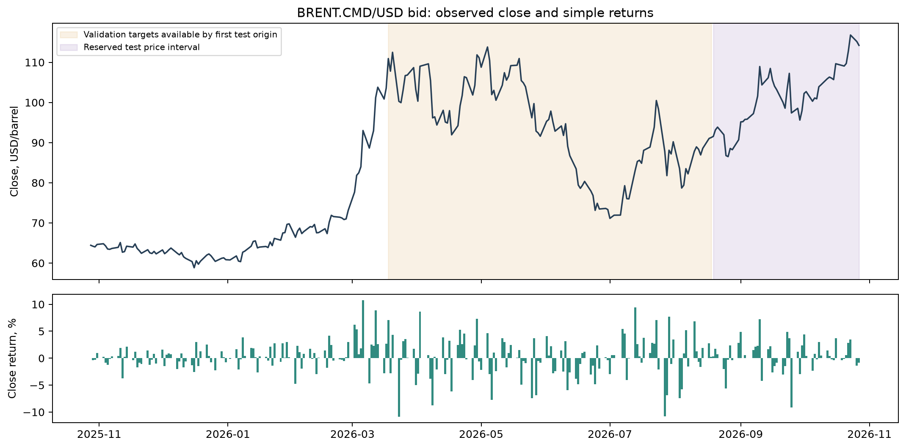
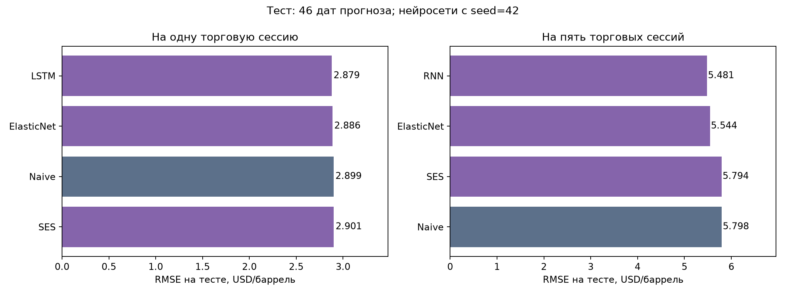
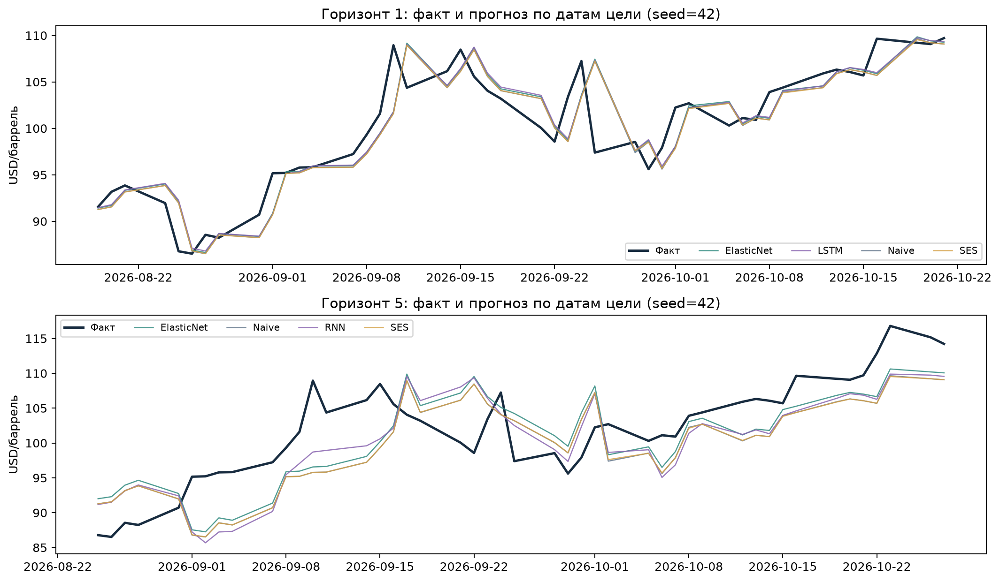
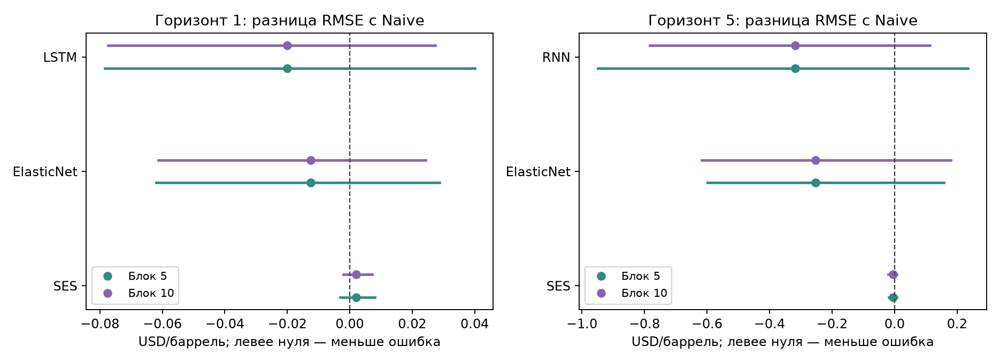

# Прогнозирование Brent

Практики 8–9 · Анализ данных и машинное обучение · Команда 4

## 1. Задача

Мы сравнили прогнозы дневной цены закрытия Brent на **1 и 5 торговых сессий**.
Проверили три вопроса: помогают ли сложные модели, как растёт ошибка с горизонтом и насколько устойчив результат.
Основной ориентир — **Naive**: будущая цена равна последней известной.

## 2. Данные

Мы использовали дневные bid-котировки **BRENT.CMD/USD**, USD за баррель.
Это CFD на Brent. Данные за **28.10.2025–27.10.2026** — год перед открытием задания **28.10.2026 в 00:00 по Москве**.
Исходный дневной архив скачали 4 ноября. Время всех загрузок сохранено в метаданных.

Источники преподавателя: [инструмент](https://www.dukascopy-node.app/instrument/brentcmdusd) и [исторический экспорт Dukascopy](https://www.dukascopy.com/swiss/english/marketwatch/historical/).

| Проверка | Результат |
|---|---:|
| Дневных строк до очистки | 365 |
| Исключено плоских записей с нулевым объёмом | 107 |
| Осталось торговых сессий | 258 |
| Часовых записей для полной сверки | 8 580 |
| Торговых дней с отличиями H1/D1 | **0** |

Из 107 исключений — 104 выходных и 25 декабря, 1 января, 3 апреля.
Нет повторов дат, пропущенных D1-строк, NaN и нарушений OHLC. Цены не заполняли и не сглаживали.
Большие скачки сохранили: они есть в исходных данных и подтверждены H1.
Все использованные часовые свечи завершились к моменту открытия задания.

Полная H1-проверка подтвердила D1, поэтому исходный ряд и прогнозы не меняли.
Часовые данные служат проверкой; основная частота работы — дневная.
Часы торгов, короткие сессии и пропуски разобраны в [описании данных](docs/data.md).



## 3. Методы

Мы сохранили четыре семейства и по пять подходов в каждом. Новые модели по результатам теста не добавляли.

| Семейство | Подходы | Настройки |
|---|---|---|
| Простые | Naive, drift, среднее, медиана, seasonal naive | Окна 5/10/20; сезонный период 5 |
| Статистика | AR, ARIMA, SES, Holt, damped Holt | 12 небольших конфигураций |
| ML | Ridge, ElasticNet, Random Forest, Gradient Boosting, SVR | По 3 конфигурации метода |
| Сети | MLP, RNN, LSTM, GRU, CNN | Размерность 8, 60 эпох, 3 seed |

Все модели используют прошлые close. ML получает 14 признаков, сети — 20 последних изменений.
Мы ограничили сложность из-за короткой выборки. Предобученных моделей нет.
Настройки и причины выбора — в [описании моделей](docs/models.md); полный перебор — в `results/validation/`.

## 4. Эксперимент

Мы начали со 100 известных цен. Затем проверяли модели по времени, без перемешивания.

| Этап | Даты выпуска прогнозов | Прогнозов на горизонт |
|---|---|---:|
| Валидация: выбор моделей | 18.03–11.08.2026 | 104 |
| Тест: оценка выбранных моделей | 18.08–20.10.2026 | 46 |

В каждый момент обучение получает только прошлые цены.
Для примера j на горизонте h требуется **j+h ≤ t**: ответ уже известен к моменту прогноза t.
Масштабирование тоже обучается только по этим примерам.
После новой сессии мы переобучаем модель на расширенной истории с прежними настройками.

Настройки выбирали по валидационному **RMSE**, затем зафиксировали до теста.
Для сетей сравнивали среднее трёх запусков; основной тестовый seed=42 задан заранее.
Даты целей внутри горизонта у всех моделей одинаковые. [Подробная схема](docs/protocol.md).

## 5. Результаты теста

RMSE и MAE указаны в USD за баррель. Меньшая ошибка лучше.
sMAPE — относительная ошибка в процентах; DA — точность направления изменения цены.

| h | Модель | RMSE | MAE | sMAPE, % | DA, % |
|---|---|---:|---:|---:|---:|
| 1 | Naive | 2.8989 | 2.0835 | 2.0814 | нет сигнала |
| 1 | SES | 2.9009 | 2.0839 | 2.0819 | 43.48 |
| 1 | ElasticNet | 2.8865 | 2.0619 | 2.0574 | 60.87 |
| 1 | LSTM | **2.8789** | 2.0658 | 2.0615 | 56.52 |
| 5 | Naive | 5.7978 | 5.1965 | 5.1837 | нет сигнала |
| 5 | SES | 5.7938 | 5.1989 | 5.1856 | 45.65 |
| 5 | ElasticNet | 5.5445 | 4.9191 | 4.9030 | 67.39 |
| 5 | RNN | **5.4807** | 4.9191 | 4.9097 | 69.57 |

У Naive нет направленного сигнала: он прогнозирует нулевое изменение.
Числовые DA=0 и coverage=0 сохранены в CSV, но не означают плохой прогноз уровня цены.
Ориентир «всегда рост» даёт **60.87% на h=1 и 67.39% на h=5**.





## 6. Насколько результат устойчив

LSTM снизила RMSE относительно Naive на **0.69%**, RNN — на **5.47%** в основном запуске.
Но все интервалы разницы ошибок с Naive включают ноль: **устойчивое преимущество не подтвердилось**.

Мы проверили временные блоки, три seed сетей и парный bootstrap блоками по 5/10 дат.
Средний RMSE RNN по трём seed — 5.5692: хуже ElasticNet с 5.5445. Один удачный запуск не решает сравнение.

ElasticNet на тесте фактически прогнозирует среднее прошлое изменение и всегда даёт рост.
Поэтому её DA совпадает с правилом «всегда рост».
RNN на h=5 угадала 32 направления из 46 против 31 у этого правила.



Сети обучались дольше: около 306 секунд на весь поиск против 73 у ML и 20 у статистики на исходной машине.
У статистики один fit даёт оба горизонта; эти затраты не равны стоимости одного прогноза.
Полные метрики, временные срезы, крупные ошибки и затраты разобраны в [анализе результатов](docs/analysis.md).

## 7. Вывод

На этом тесте лучший RMSE получили LSTM/RNN, по MAE немного лучше ElasticNet.
Уверенного общего победителя нет. Naive остаётся сильным простым ориентиром.
На 5 сессиях ошибка всех моделей выше, чем на одной.

Вывод ограничен одним годом, 258 ценами, 46 тестовыми датами и выбранной сеткой настроек.
Мы проверили две частоты одного поставщика; независимого второго источника нет.
Торговую прибыль и издержки не оценивали. Для применения нужны новые периоды и отдельная проверка стратегии.

## 8. Запуск

Нужен Python 3.12. Из корня проекта в Windows:

```powershell
py -3.12 -m venv .venv
.venv/Scripts/python.exe -m pip install -r requirements-dev.txt
.venv/Scripts/python.exe -m ruff check src tests
.venv/Scripts/python.exe src/reproduce.py
```

В Linux/macOS используйте `.venv/bin/python`.
Проверка работает в отдельной копии: опубликованные данные, прогнозы и документы не перезаписывает.
Она сверяет H1/D1, границы обучения, метрики, контрольные суммы, ссылки и числа README, затем запускает тесты.

Полное повторное обучение: `python src/reproduce.py --retrain` в установленном окружении.
Сравнение прогнозов использует допуск 1e-6 USD. Точный результат зависит от платформы и версий библиотек.
Без этого флага модели заново не обучаются: проверяются сохранённые результаты.

Повторная загрузка H1 требует Node.js и pnpm: `pnpm install --frozen-lockfile`, затем `node src/download_data.cjs --full-h1`.
Для обычной проверки интернет не нужен — данные включены в репозиторий.

Основные папки: `data/` — котировки, `config/` — настройки, `src/` — код, `tests/` — проверки, `results/` — результаты.
Краткие ответы на вопросы — [docs/defense.md](docs/defense.md), история изменений — [CHANGELOG.md](CHANGELOG.md).
Исходный эксперимент сохранён в Git и контрольных суммах `provenance/`. Автопроверки настроены в GitHub Actions.
